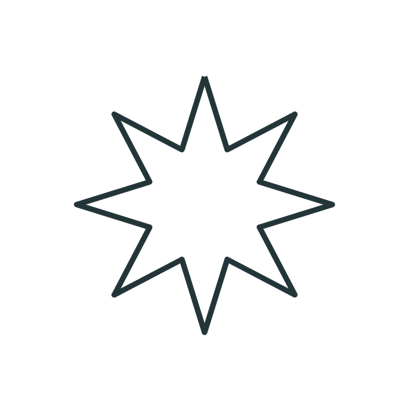
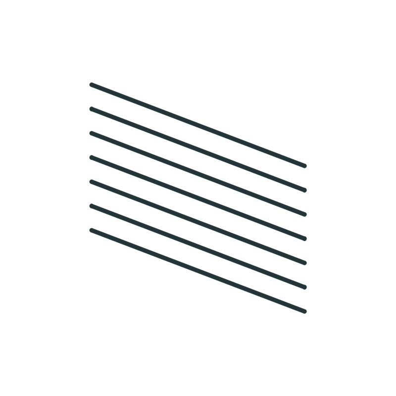
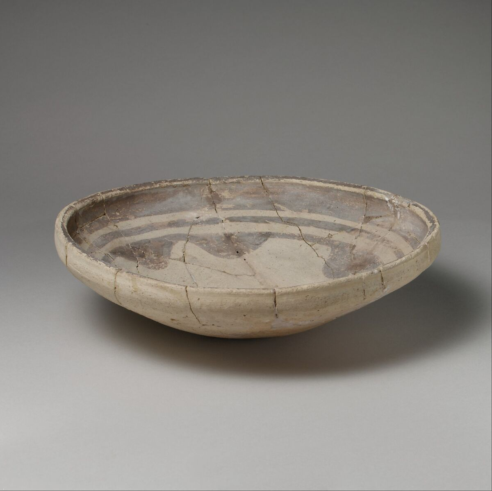
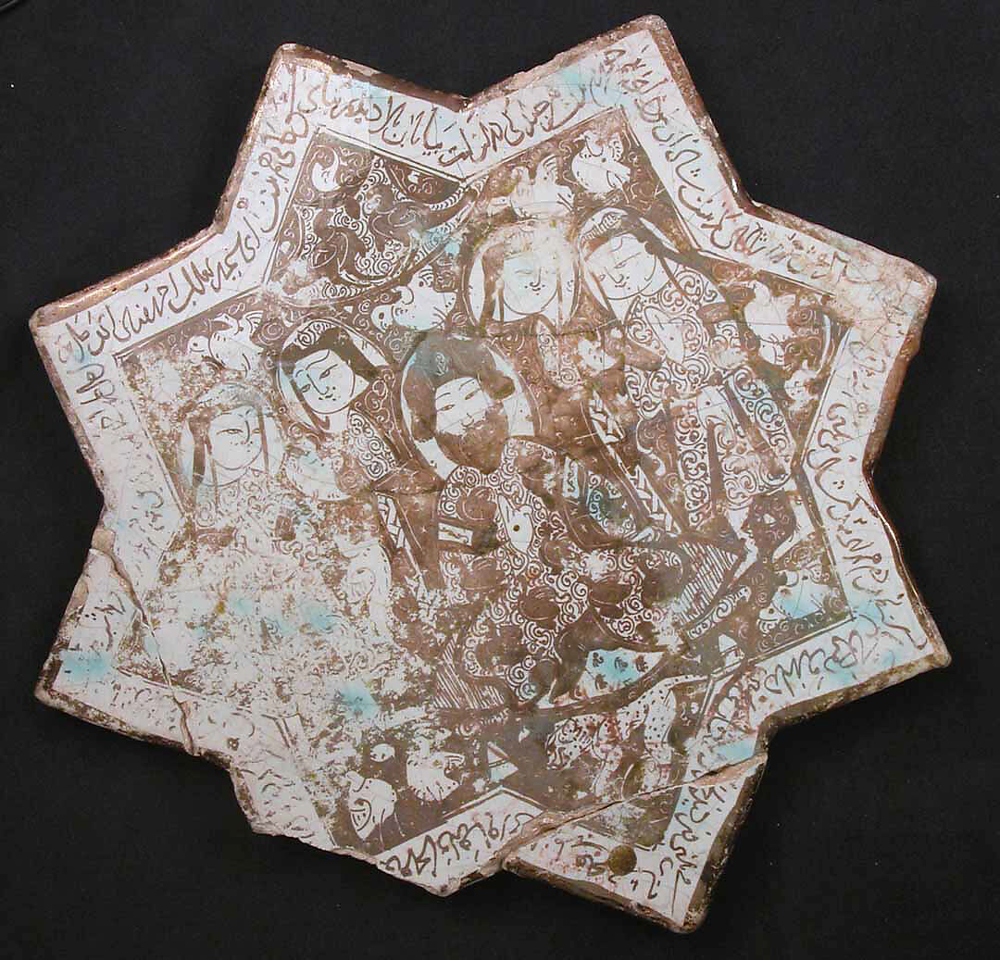
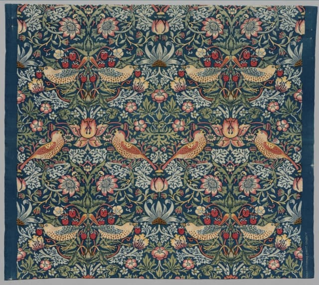

# Geometry & Ornament Library

**First collection · 20 October 2026 · Candidate research and studio material**

| A boundary | An opening | A radial construction | A mark field |
|---|---|---|---|
|  |  |  |  |

| Geometry on a vessel | Geometry becomes a carrier | Geometry organizes figurative ornament |
|---|---|---|
|  |  |  |
| [Ubaid bowl, Met 49.133.2](https://www.metmuseum.org/art/collection/search/324086) | [Kashan tile, Met 40.181.1](https://www.metmuseum.org/art/collection/search/450358) | [Morris design, Cleveland 1937.696](https://www.clevelandart.org/art/1937.696) |

These images establish the library’s first question: **how does a geometric unit change its role when it becomes a mark, an object, an arrangement, a tool, or a surface for further design?** Text supplies the distinctions needed to look, make, and compare.

## Five connected views

| View | What belongs here | Initial contents |
|---|---|---|
| **Cells** | Selectable units that can become layers or components of larger designs | 12 original studio cell families |
| **Cultural forms and iconography** | Identifiable objects, situated motifs, tools, surfaces, and source-supported meanings | 11 artifacts; 10 reusable reference images |
| **Comparisons** | Bounded questions about similarities and differences in production and choice | 5 comparisons |
| **Ornament histories** | Dated episodes linked by medium, technique, use, exchange, and revival | 10 episodes for branching historical browsing |
| **Geometry and invention** | Cases in which geometry is depicted, embodied, circulated, and applied again | 4 reciprocal case studies |

The portable records are in [catalog.json](catalog.json). Each new entry remains **candidate**. A museum’s attribution can be well supported while our selection, comparison, or proposed interpretation still awaits review.

## Cells: useful units that remain editable

A cell is atomic **for the current act of making**. One arc can be a cell. Two arcs can form a petal that becomes another selectable unit. A rosette can subsequently function as a cell in a border. Retaining the components lets the maker return to a smaller working scale.

The opening construction study follows five stages: **one 120-degree arc; a mirrored two-arc petal; six rotated petals; a nested arrangement; a border**. This shows how the same material of design can act at several scales. It does not assert historical transmission or literal mathematical fractality.

| Code | Cell | Making action | Mathematical attention |
|---|---|---|---|
| C01 | Dot | Place and space marks | Position, distance, counting |
| C02 | Line segment | Join selected endpoints | Length, direction, intersection |
| C03 | Arc | Sustain a turning stroke | Radius, sweep, chord for circular arcs |
| C04 | Circle / disk | Close a boundary; distinguish fill | Radius, circumference, area |
| C05 | Crescent | Offset two curved boundaries | Displacement, intersection, difference |
| C06 | Triangle | Place vertices and connect edges | Angles, area, similarity |
| C07 | Square / frame | Align and subdivide a field | Perpendicularity, ratios, partition |
| C08 | Wave | Repeat a turning gesture | Periodicity, amplitude, phase |
| C09 | Planar spiral | Turn while changing distance | Turn spacing and radial change |
| C10 | Star | Divide directions and connect points | Angular division, rotational symmetry |
| C11 | Hatch field | Repeat strokes to build value | Spacing, density, local direction |
| C12 | Crossed hatch field | Overlay stroke families | Crossing angles, subdivision, density |

These are starting families, not an exhaustive ontology. A dot is a physical mark rather than an ideal point. A freehand wave need not be sinusoidal. A pointed silhouette, intersecting star polygon, and two overlapping squares are different constructions. Naming the chosen construction makes practice reproducible without forcing every artifact into it.

## Alignment with the FGE syntax

This collection follows distinctions in the user-provided `FGE-Syntax.txt`; the complete private source is not reproduced here.

**`prim` remains abstract geometry.** It can include atomic elements and accepted, stabilized GEMs. Material, force, and duration do not enter the abstract cell definition. **`prepared_prim` attaches a carrier.** A proposed studio cell therefore has geometric parameters, while its making study separately records the selected tool and support.

**`F(ge)` and `M(ge)` remain coequal but distinct.** Physical function belongs to the PFMD account of making. An aesthetic, semiotic, or metaphorical reading belongs to a situated interpretation. Calling an arrangement “enclosing” or “directing attention” does not convert that visual predicate into mechanical `F(ge)`.

`prim(tool)` can decompose a tool; `ge(tool)` can also examine contours, negative spaces, and paths. The collection preserves **epoch recursion** as return through changed material and social contexts. GECD.FGE is treated as a grammar, and a profile follows acceptance rather than being manufactured from every newly collected image.

## The first artifact collection

| Object | Attributed date and context | What to inspect |
|---|---|---|
| [Ubaid bowl](https://www.metmuseum.org/art/collection/search/324086), 49.133.2 | Mid sixth–fifth millennium BCE; Eridu | Rings, paired curved forms, and the vessel boundary |
| [Naqada I bowl](https://www.metmuseum.org/art/collection/search/547264), 10.130.1174 | About 3700–3650 BCE; Egypt | Repeated angular line bundles on a curved wall |
| [Banshan jar](https://www.metmuseum.org/art/collection/search/44723), 1992.165.9 | About 2650–2350 BCE; northwest China | Curved shoulder fields and angular neck fields |
| [Old Babylonian seal](https://www.metmuseum.org/art/collection/search/327455), 1991.368.1 | About eighteenth century BCE | Cylinder and modern impression; horizontal figure sequence |
| [Old Syrian seal](https://www.metmuseum.org/art/collection/search/327459), 1991.368.5 | About 1820–1730 BCE; Syria | Disk, crescent, stars, looping bands, and stacked figures |
| [Kudurru](https://artsandculture.google.com/asset/boundary-stone-kudurru/bQGp47h1MZdloA), 1907,1014.1 | 1125–1100 BCE; Middle Babylonian | Named emblems within a land-grant document; linked reference |
| [Luster star-shaped tile](https://www.metmuseum.org/art/collection/search/450358), 40.181.1 | 1211–12 CE; attributed to Kashan | Star-shaped host, image field, and writing |
| [Mihrab](https://www.metmuseum.org/art/collection/search/449537), 39.20 | 1354–55 CE; Isfahan | Small cut tiles assembled across nested architectural fields |
| [Parfleche](https://www.clevelandart.org/art/1937.848), 1937.848 | About 1900; Apsaalooke | Triangular fields, flaps, fold, and closure |
| [Strawberry Thief](https://www.clevelandart.org/art/1937.696), 1937.696 | **1883 design; selected textile about 1936** | Repeated birds, curved stems, and local bilateral arrangements |
| [The Grammar of Ornament](https://www.nga.gov/artworks/102555-grammar-ornament), 1997.109.1 | 1856; Owen Jones | A printed page that isolates and redistributes ornament |

The Banshan curves are recorded as visible curved arrangements, not as exact logarithmic spirals. The Ubaid curved forms are not assigned the later crescent’s divine identity. The kudurru is retained as a link because the consulted image record did not establish a reusable image license.

## Comparisons that preserve difference

The strongest initial contemporary comparison is between the **Old Babylonian and Old Syrian seals**. Their approximate period, hematite material, and reproductive action provide a useful shared basis. Their scene organization and selected iconographic combinations differ. Two examples cannot establish a preference of an entire civilization.

The **three painted vessels** support a different comparison: a rounded host can receive concentric organization, angular repetition, or sweeping curves. They are not contemporary; this is a comparison of formal and material possibilities.

A third study follows **curved forms across bowl, seal, and stone document**, asking when a geometric observation becomes a source-supported iconographic identification. A fourth compares **whole shaped tile and assembled architectural mosaic**. A fifth compares **folded portable container and repeat-printed furnishing**, holding the bounded surface in view while examining closure, seam, and repeat.

A similarity is a useful finding. Shared meaning, contact, adaptation, and transmission each require additional evidence.

## The fifth point: geometry returns through invention

An invention can be pottery, a seal, a building, a textile-production process, or a printed sourcebook. The relevant relationship is reciprocal:

- **Geometry is depicted:** a mark or arrangement appears on a surface.
- **Geometry is embodied:** an artifact, tool, or building has a geometry that enables and constrains action.
- **Geometry appears anew:** that artifact provides surfaces, boundaries, scales, or reproductive possibilities for further ornament.

These roles can coexist. The library does not require every culture to have followed a single sequence from sketch to invention to decoration. Its [concept map](concept-map.mmd) records returns and constraints as well as outward development.

### Four opening cases

**Seal.** A carved cylindrical surface produces a planar impression through rolling. Ownership and transaction contexts provide an evidenced pathway for repeated encounter with imagery. A flat preparatory sketch is a useful modern exercise; the selected objects do not establish that ancient design stage. For an ideal cylinder rolling without slipping, one revolution advances its circumference, providing a precise mathematics connection.

**Tiles.** The star tile and the mihrab show different relations between a shaped ceramic unit and a larger field. They supply comparisons of assembly, border, scale, and support. They do not prove that the earlier tile directly generated the later niche.

**Morris.** Drawing, dyeing, discharge, registration, and repeat production interact. The [William Morris Gallery](https://wmgallery.org.uk/object/strawberry-thief/) describes an expensive process alongside commercial success; the [V&A](https://www.vam.ac.uk/articles/willam-morris-textiles) explains production. This distinguishes circulation from affordability. The posthumous textile example also makes design date and object date separately visible.

**Sourcebook.** Jones’s publication turns ornament into a reproduced reference that other makers can encounter. The [V&A’s account](https://www.vam.ac.uk/articles/owen-jones-and-the-grammar-of-ornament) connects observation, reproduction experiments, and design education. Documentation itself becomes a carrier. Its selections and historical classifications remain part of the evidence, rather than becoming the library’s unquestioned global categories.

## Investigating saturation of a concept

“Saturation” is an open research dimension: frequency of encounter, geographic circulation, production volume, price relative to income, household use, permission to own or make, cross-medium reuse, duration, and revival. These fields currently have **no measured values**.

A publicly familiar motif may still belong to expensive goods or restricted institutions. Record both familiarity and participation. This permits the user’s democratic-resonance hypothesis to be investigated with evidence rather than assumed from repetition alone.

## First studio study: observe, rebuild, redesign

Choose one vessel image. Identify a single mark, a candidate repeated unit, and an overall arrangement. Keep the source image visible next to the study.

Rebuild a short sequence on paper, preserving one chosen relation. Retain its components as layers. Wrap a copy around a paper cylinder and inspect the seam, spacing, and changed view. Record the carrier and making action separately from the geometric definition.

Redesign by changing one variable. Describe the visual result in the learner’s own words; do not prescribe a universal emotion. Keep observation, tool execution, and design choice separate so a learner can demonstrate understanding even when a particular hand or instrument needs support. This is a proposed activity, not a measured learning result or a fixed age threshold.

## Connect and extend

The collection connects to the existing [Rosetta Stone schema](../primitive-engine-rosetta-stone.schema.json) and [Primitive Cell Studio](../../PRIMITIVE_CELL_STUDIO.md) through [uml-crosswalk.json](uml-crosswalk.json).

The new **studio cell** is broader than the existing `primitive_cell` definition for a sufficient generating region. That older identity remains intact. The code’s axis/cone/ribbon `spiral` also remains distinct from this collection’s planar spiral.

Next additions should address the directly sourced **wave** gap, more drawing-technique evidence, wider geography, and community-authored histories of mobile societies. Each addition should contribute a useful distinction: a new form, an alternative making method, a different carrier, a source-supported meaning, or a counterexample. Terms, forms, artifacts, image readings, and claims retain separate identifiers so future corrections can refine the collection without erasing its history.
