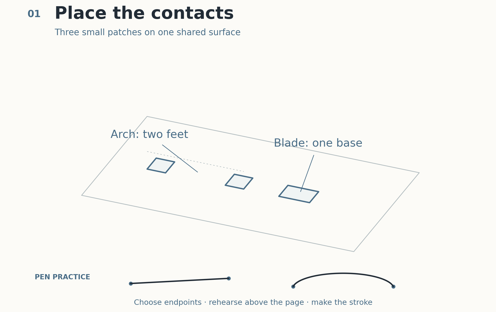
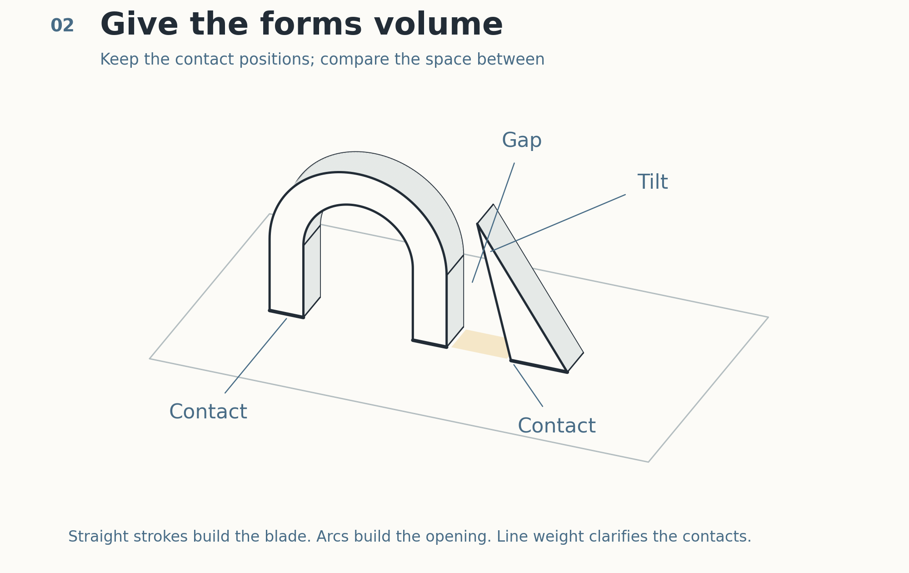
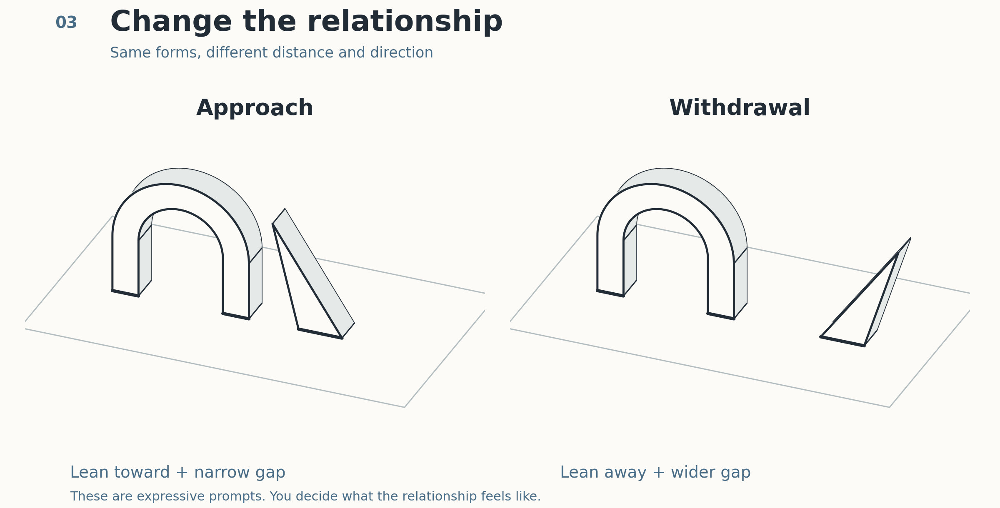

# Invented Forms on a Shared Surface

**Date:** November 27, 2026, America/Phoenix  
**Project:** Learning to Drawu / Line All Richie  
**Status:** Proposed practice lesson; no drawing assessed or completion claimed.

## Plumage

Today, draw two unfamiliar forms that seem to approach—or withdraw from—each other while sharing one surface. Use a thick open loop and an asymmetric, leaning wedge. One page, an ordinary pen, about 25 minutes.

This combines confident strokes, constructing volume, placing forms in depth, designing negative space, and expressing a relationship through tilt and spacing. The exercise is an original proposal tailored to the user's stated goals.

| What you practice | What it does in this drawing |
| --- | --- |
| Planned curves and straight strokes | Construct the loop and the wedge |
| Form and perspective | Give each silhouette thickness and a base |
| Placement, gap, and overlap | Establish where the forms stand relative to one another |
| Line weight and short hatching | Clarify contact, nearer edges, and turning surfaces |
| Nonrepresentational expression | Explore approach and withdrawal through the arrangement |

## 1. Establish the surface and the contact patches — 5 minutes

Draw a shallow four-sided platform viewed from above and to one side. Plan three small contact patches on it: two for the loop's feet and one for the wedge's base. These are the places where the forms meet the surface. With pen, mark only their nearest corners as tiny dots and imagine the full patches; the blue outlines in the diagram explain the construction and need not be drawn through the finished forms. Keep their orientations consistent with that surface. They do not all need to line up horizontally on the page.

Use sparse dots to plan corners. Before a straight edge or curve, rehearse the movement just above the paper two or three times, then make the mark. Rotate the page to a comfortable direction. Practice three straight strokes and three broad arcs in the margin, using the same motions the forms will need. This adapts Drawabox's planning, preparation, and execution approach.[1]

For this lesson, judge stroke confidence by whether you chose and carried through a path. Some wavering can remain. If an edge needs correction, choose one clearer correction rather than repeatedly darkening the whole contour.

## 2. Grow the forms and design the space between them — 10 minutes

From the two feet, draw a broad open loop. Give it thickness by adding a second offset edge and connecting the visible ends. From the other contact patch, raise a wedge: broad at the base, narrower toward its upper end, with a deliberately leaning axis. Show one side face so it reads as a solid.

Turn the wedge toward the loop. Leave a distinct, shaped gap between them. Look at that gap as a form of its own: does it narrow at the top, widen toward the surface, or produce an angled opening? The area between forms is negative space; treating its shape deliberately is a standard drawing strategy.[2]

Keep both forms attached to the platform. Add only a few short dark marks where each meets it. Where one form hides another, preserve the nearer contour and stop the farther contour at it. Keep the platform edge from running through an opaque form. Choose a clear gap or a clear overlap rather than an accidental barely-touching contour.

With a single fixed-width pen, denser short hatching can supply darker accents without assuming the pen responds to pressure. Keep most edges simple. The illustration is a construction aid; you may change the silhouettes while preserving contact and depth.

## 3. Change the relationship — 8 minutes

Make two small versions of the same pair. Keep the platform's view and the forms' basic identities recognizable.

**Approach:** lean the wedge toward the loop and compress their gap. You may place part of the wedge behind the loop if you want to practice overlap.

**Withdrawal:** angle the wedge away and increase the gap. Let the empty space become the largest change in the image.

These are expressive prompts, not universal meanings assigned to shapes. See whether the difference reads to you before adding details. Use the same small family of straight strokes and arcs in both versions. Finish with a few directional hatch marks on one side face and short contact accents under the feet.

If you want a more unusual variation, bend the loop asymmetrically while preserving its thickness and planted feet. If the surface relationship becomes unclear, simplify the silhouettes and restore the contacts before adding anything else.

## What to look for when you finish

- Can you point to the place where each form meets the platform?
- Is the space between them a deliberate shape?
- Can you tell which contour is in front wherever the forms overlap?
- Does changing tilt and distance change the apparent relationship?

Choose the version that communicates most clearly. Add detail only if it strengthens that relationship.

## Source conversation

**User's initial request:**

> What should I learn today. I only have pens. I still need confident strokes but I want to learn objects in relation on a surface.

**User's clarification:**

> I don’t want to use anything literal or what I see all the time. I always want to multitask.

The initial household-object proposal was replaced by the abstract-form exercise above. The clarified preference is for unfamiliar or nonliteral subjects and lessons that work on several connected abilities at once. No inference about the user's drawing performance is made without a submitted drawing.

## Conceptual mapping

[Linked curriculum map](../06_visual_indices/2026-11-27_relational_drawing_concept_map.md) · [Machine-readable relationships](../06_visual_indices/2026-11-27_relational_drawing_concept_map.json)

**Primary learning target:** relational composition on a shared surface.

| From | Relationship / operation | To |
| --- | --- | --- |
| Planned straight or curved stroke | establishes | edge or directional axis |
| Contact patch | locates and constrains | solid on a supporting plane |
| Primitive silhouette | gains thickness | volumetric form |
| Form A and Form B | delimit | negative-space shape |
| Near contour | occludes | farther contour |
| Tilt and spacing | vary | intended expressive relationship |
| Contact accent | clarifies | form–surface junction |

**Progressions practiced together:** mark to form; form to spatial relationship; spatial relationship to expressive composition. This is a lesson-level mapping, not a change to the project's accepted theory or UML.

## References

[1] Drawabox, instructor explanation of ghosting as planning, preparation, and execution: https://drawabox.com/r/artfundamentals/post/l22fts

[2] Getty, *How to Draw a Still Life*, negative space between forms: https://www.getty.edu/education/teachers/classroom_resources/curricula/arts_lang_arts/a_la_lesson28.html

Local project sources consulted: `04-PROJECT-INSTRUCTIONS-use-this-one-Supplement-with-othrr-.txt`; `02-Project-instructions.txt`; `07-Curriculum-Progression-.txt`.

## Running Project Sum

**Current thread:** pen-only practice combining confident strokes with forms related on a surface. **Preference clarified:** unfamiliar, nonliteral subjects; practice several connected skills in the same drawing. **Concepts added:** contact patches, shared plane, purposeful negative space, abstract gesture through tilt and distance. **Visuals:** three raster construction studies. **GitHub export candidates:** this lesson, its images, and the conceptual mapping. **Open question for the next drawing:** which change—tilt, distance, or overlap—most clearly changes the relationship?
