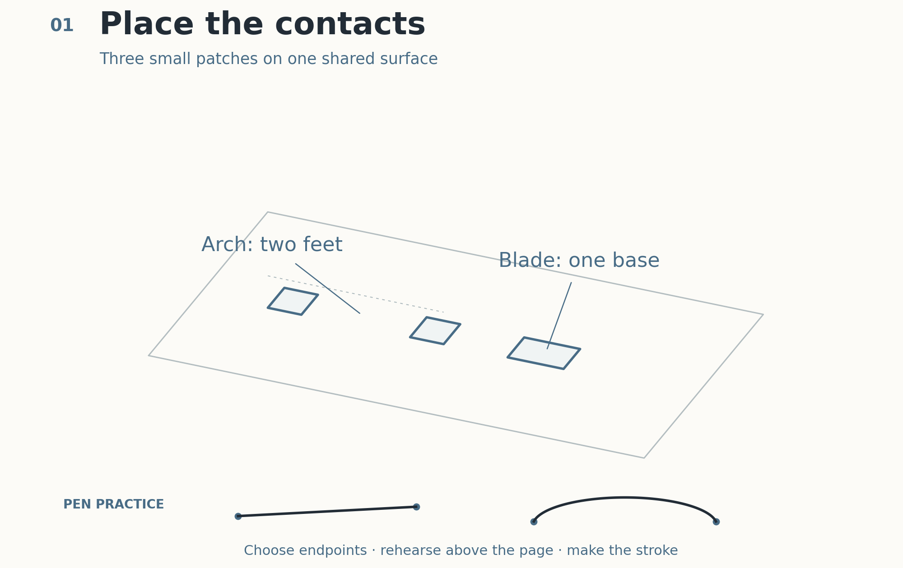
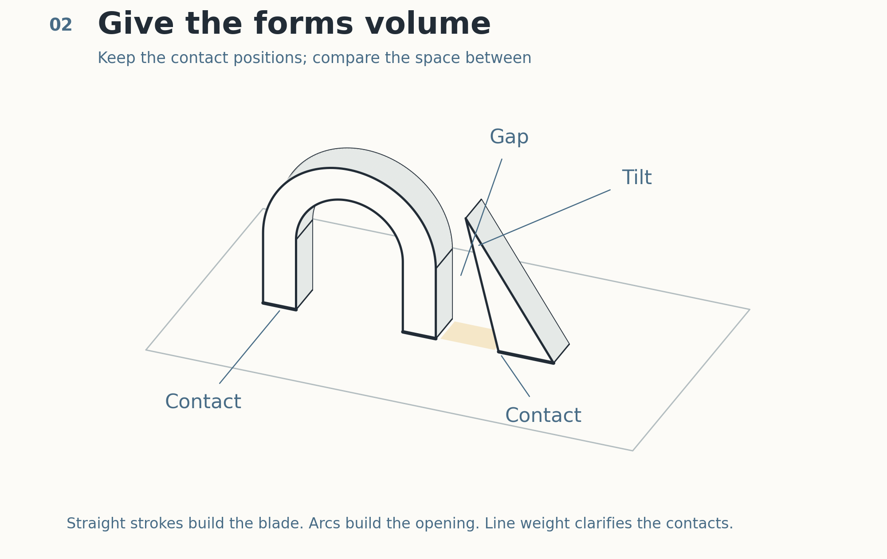
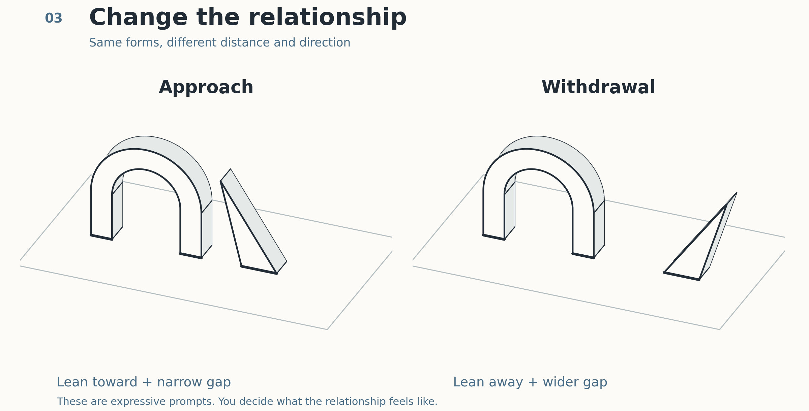

# Invented Forms on a Shared Surface — Conceptual Map

**Date:** November 27, 2026, America/Phoenix  
**Status:** Proposed lesson mapping; no learner assessment or change to accepted theory.

[Open the complete lesson](../05_drills/2026-11-27_invented_forms_shared_surface.md) · [Open the relationship JSON](2026-11-27_relational_drawing_concept_map.json)

## Connected skills

| Lesson action | Drawing relationship | Existing curriculum destination |
| --- | --- | --- |
| Plan and execute straight strokes and curves | Stroke establishes an edge or directional axis | [Line control](../03_skill_fields/line_control.md) |
| Place contact patches on one platform | Contact locates a solid on a supporting plane | [Perspective](../03_skill_fields/perspective.md) |
| Add thickness to loop and wedge silhouettes | Silhouette becomes a volumetric form | [Primitive forms](../03_skill_fields/primitive_forms.md) |
| Compare spacing, negative space, tilt, and overlap | Forms delimit a gap and establish a spatial relationship | [Composition](../03_skill_fields/composition.md) |
| Add short contact accents and directional hatching | Mark density clarifies contact and turning surfaces | [Light and value](../03_skill_fields/light_value.md) |

These are links to existing curriculum locations. No linked skill document is modified.

## Parallel progressions

- Mark → form: one planned stroke contributes to an edge, axis, or surface.
- Form → spatial relation: contact, gap, and overlap locate forms together.
- Spatial relation → expressive composition: tilt and spacing explore approach or withdrawal.

The expressive readings are prompts to explore, not universal meanings assigned to shapes.

## Raster construction studies

### Contact patches and planned strokes

### Two forms on a shared surface

### Changing the relationship

## Existing UML relationship

Unresolved. An existing UML model was not identified in the inspected repository locations. This lesson-level map records conceptual relations without claiming a link to an established UML model or changing one.

## Evidence and assessment

The [lesson](../05_drills/2026-11-27_invented_forms_shared_surface.md) preserves the source request and the clarification favoring nonliteral, unfamiliar subjects and simultaneous practice of connected skills. No drawing was supplied for assessment; mastery and completion are not claimed.
